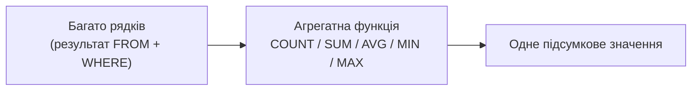

# Лекція 8. Агрегатні функції: AVG, COUNT, MIN, MAX, SUM

*Досі кожен рядок результату відповідав одному рядку таблиці (чи
поєднанню рядків після `JOIN`). Агрегатні функції — перший інструмент,
що робить інакше: замість "рядок за рядком" вони згортають **багато**
рядків у **одне** підсумкове значення — "скільки всього тварин?",
"яка середня вартість візиту?", "скільки років наймолодшій тварині?".*

## 1. Що таке агрегатна функція

```sql
SELECT COUNT(*) FROM animals;
-- одне число: скільки всього рядків у animals
```

На відміну від звичайного `SELECT id, name FROM animals`, який повертає
стільки рядків результату, скільки рядків у таблиці, агрегатна функція
бере **всі** рядки, що потрапили під `WHERE` (чи всю таблицю, якщо
`WHERE` немає), і повертає **один** рядок результату. SQLite (як і
більшість СУБД) має п'ять базових агрегатних функцій: `COUNT`, `SUM`,
`AVG`, `MIN`, `MAX`.

## 2. COUNT: скільки рядків

```sql
SELECT COUNT(*) FROM animals;
-- усі рядки, включно з тими, де якісь колонки NULL

SELECT COUNT(owner_id) FROM animals;
-- лише рядки, де owner_id НЕ NULL
```

Ключова відмінність: `COUNT(*)` рахує рядки безумовно, а `COUNT(колонка)`
рахує лише рядки, де ця колонка **не** `NULL` — `NULL` пропускається,
а не рахується як 0 чи як окреме значення. Якщо в `animals` є тварина
без власника (`owner_id IS NULL`), `COUNT(owner_id)` дасть число на
одиницю менше, ніж `COUNT(*)`.

## 3. SUM і AVG: сума і середнє

```sql
SELECT SUM(age) FROM animals;   -- сума віку всіх тварин
SELECT AVG(age) FROM animals;   -- середній вік
```

`SUM` і `AVG` працюють з числовими колонками й, як і `COUNT(колонка)`,
**ігнорують** `NULL` — рядок із `NULL` у цій колонці не додається до
суми і не входить до знаменника при діленні для `AVG`. Це означає:
`AVG(колонка)` — це не "сума колонки поділена на `COUNT(*)`", а "сума
колонки поділена на `COUNT(колонка)`" — різниця стає помітною, щойно в
таблиці з'являється хоч один `NULL`.

## 4. MIN і MAX: не лише для чисел

```sql
SELECT MIN(age), MAX(age) FROM animals;      -- наймолодша й найстарша тварина
SELECT MIN(visit_date) FROM visits;          -- найраніший візит (текстові дати ISO сортуються коректно)
SELECT MIN(last_name) FROM owners;           -- навіть текст: "найменше" за алфавітом
```

`MIN`/`MAX` працюють з будь-яким типом, який можна порівнювати —
числа, дати у форматі `YYYY-MM-DD` (сортуються як звичайний текст,
тому що ISO-формат зберігає алфавітний порядок = хронологічний), і
навіть звичайний текст (алфавітний порядок). Як і решта агрегатних
функцій, `NULL`-рядки не враховуються.

## 5. Кілька агрегатних функцій в одному запиті

```sql
SELECT
    COUNT(*)   AS total_animals,
    AVG(age)   AS average_age,
    MIN(age)   AS youngest,
    MAX(age)   AS oldest
FROM animals;
```

Один `SELECT` може обчислити скільки завгодно агрегатних функцій одразу
— кожна незалежно згортає весь набір рядків у своє власне підсумкове
число, і всі результати потрапляють в один-єдиний рядок відповіді.

## 6. Агрегат + WHERE: фільтр діє ДО згортання

```sql
SELECT COUNT(*) FROM animals WHERE species = 'кіт';
-- рахує тільки котів: WHERE відсіює рядки ДО того, як COUNT їх побачить
```

`WHERE` виконується раніше за агрегатну функцію (нагадування порядку
виконання з Лекції 3: `FROM → WHERE → SELECT`) — тож `COUNT`, `AVG`
чи будь-яка інша агрегатна функція бачить лише ті рядки, що вже
пройшли фільтр `WHERE`. Це природно для фільтрів на рівні **окремого
рядка** ("тільки коти", "тільки візити 2026 року"). Але що робити,
якщо умову потрібно накласти вже на результат агрегації — наприклад,
"тільки ті власники, у яких **більше однієї** тварини"? Про це — уже в
Лекції 9 (`GROUP BY`, `HAVING`): агрегатна функція без `GROUP BY`
завжди згортає **всю** таблицю в один рядок; щоб отримати підсумок
**по кожній групі** (по кожному власнику, по кожному виду тварини),
потрібен саме `GROUP BY` — наступний крок.



## 7. Розбір на повному прикладі

Щоб побачити всі правила разом, візьмемо невелику базу ветеринарної клініки. Таблиця `animals` містить п'ять тварин, причому в однієї вік невідомий (`NULL`), а в іншої немає власника:

| id | name | species | age | owner_id |
|---|---|---|---|---|
| 1 | Мурка | кіт | 3 | 1 |
| 2 | Барсик | кіт | 5 | 1 |
| 3 | Рекс | собака | 7 | 2 |
| 4 | Бім | собака | `NULL` | 2 |
| 5 | Пушок | хом'як | 1 | `NULL` |

Таблиця `visits` зберігає візити до лікаря: дату і вартість. В одному з двох візитів тварини Рекс вартість ще не внесена, тому там теж `NULL`:

| id | animal_id | visit_date | cost |
|---|---|---|---|
| 1 | 1 | 2026-01-10 | 400 |
| 2 | 1 | 2026-03-02 | 250 |
| 3 | 2 | 2026-02-14 | 600 |
| 4 | 3 | 2026-02-20 | `NULL` |
| 5 | 3 | 2026-05-05 | 900 |

Спершу порівняємо чотири способи порахувати рядки:

```sql
SELECT COUNT(*)               AS all_rows,
       COUNT(age)             AS with_age,
       COUNT(owner_id)        AS with_owner,
       COUNT(DISTINCT species) AS species_kinds
FROM animals;
```

```text
all_rows  with_age  with_owner  species_kinds
5         4         4           3
```

`COUNT(*)` бачить усі п'ять рядків. `COUNT(age)` і `COUNT(owner_id)` пропускають по одному рядку, де в колонці `NULL`. Нове для вас `COUNT(DISTINCT species)` рахує не рядки, а **різні значення** колонки: у таблиці є кіт, собака і хом'як, тобто три види, хоча тварин п'ять.

Тепер сума й середнє по віку:

```sql
SELECT SUM(age) AS total_age,
       AVG(age) AS avg_age,
       SUM(age) * 1.0 / COUNT(*) AS naive_avg
FROM animals;
```

```text
total_age  avg_age  naive_avg
16         4.0      3.2
```

Сума віків дорівнює 3 + 5 + 7 + 1 = 16. `AVG(age)` ділить її на 4, тобто на кількість рядків із відомим віком, і дає 4.0. Якщо ж поділити ту саму суму на `COUNT(*)`, тобто на 5, вийде 3.2: це інше число, і воно хибне, бо тварину без відомого віку не можна вважати нульовою. Саме тому `AVG` ігнорує `NULL` повністю: і в чисельнику, і в знаменнику.

Підсумки по візитах:

```sql
SELECT MIN(visit_date) AS first_visit,
       MAX(visit_date) AS last_visit,
       SUM(cost)       AS revenue,
       AVG(cost)       AS avg_cost,
       COUNT(cost)     AS priced_visits,
       COUNT(*)        AS all_visits
FROM visits;
```

```text
first_visit  last_visit  revenue  avg_cost  priced_visits  all_visits
2026-01-10   2026-05-05  2150.0   537.5     4              5
```

Виручка 2150 складається з чотирьох відомих вартостей (400 + 250 + 600 + 900), а середній чек 537.5 одержано діленням на 4, а не на 5. Різницю між `priced_visits` і `all_visits` корисно виводити поруч із середнім: вона одразу показує, скільки даних пропущено.

## 8. Типові помилки

**Агрегатна функція у `WHERE`.** Спроба відфільтрувати за результатом агрегації не працює:

```sql
SELECT COUNT(*) FROM animals WHERE COUNT(*) > 1;
```

```text
Error: misuse of aggregate: COUNT()
```

`WHERE` виконується до згортання (розділ 6), тому на цьому етапі підсумкового числа ще не існує. Умови на результат агрегації з'являться разом із `HAVING` у Лекції 9.

**Агрегат поруч зі звичайною колонкою.** Запит `SELECT name, MAX(age) FROM animals;` у SQLite виконається без помилки й поверне Рекс і 7. Це особливість SQLite: коли в запиті є єдиний `MAX` чи `MIN`, значення звичайної колонки береться з рядка, де знайдено екстремум. Інші СУБД, зокрема PostgreSQL, відхиляють такий запит із помилкою. Не покладайтеся на цю особливість: щоб побачити, хто саме найстарший, пишіть `SELECT name, age FROM animals ORDER BY age DESC LIMIT 1;`, а колонки разом з агрегатами поєднуйте лише через `GROUP BY` (Лекція 9).

**Порожній набір.** Якщо під `WHERE` не потрапив жоден рядок, поведінка різна:

```sql
SELECT SUM(cost), COUNT(*), TOTAL(cost) FROM visits WHERE animal_id = 99;
```

```text
SUM(cost)  COUNT(*)  TOTAL(cost)
NULL       0         0.0
```

`COUNT(*)` дає 0, а `SUM` дає `NULL`, а не нуль. Якщо результат потрапляє у звіт чи розрахунок, це може зламати арифметику. Виходи два: обгорнути суму в `COALESCE(SUM(cost), 0)`, або скористатись функцією `TOTAL`, яка є особливістю SQLite і повертає `0.0` для порожнього набору.

**`NULL`, замінений на нуль, спотворює середнє.** Вираз `AVG(COALESCE(age, 0))` дасть 3.2 замість 4.0: невідомий вік тепер рахується як нуль років. Замінювати `NULL` значенням за умовчанням потрібно лише тоді, коли це справді відповідає змісту даних.

## 9. Запитання для самоперевірки

**У таблиці 10 рядків, у колонці `phone` заповнено 7 значень, решта `NULL`. Що поверне `COUNT(phone)`?**

Число 7: функція рахує лише рядки, де колонка не `NULL`. `COUNT(*)` для тієї самої таблиці дасть 10.

**Колонка `price` має значення 100, 200 і `NULL`. Чому дорівнює `AVG(price)`?**

150, тобто (100 + 200) / 2. Рядок із `NULL` не входить ні в суму, ні в кількість.

**Чим `COUNT(DISTINCT species)` відрізняється від `COUNT(species)`?**

`COUNT(species)` рахує всі непорожні значення, включно з повторами, а `COUNT(DISTINCT species)` рахує лише різні. Для п'яти тварин з прикладу вище це 5 і 3 відповідно.

**Чому запит `SELECT * FROM animals WHERE AVG(age) > 3` завершується помилкою?**

`WHERE` фільтрує окремі рядки до того, як будь-яка агрегатна функція почне працювати, тож середнього ще не існує. Для умов на агрегат потрібен `HAVING` (Лекція 9).

**Скільки рядків повертає `SELECT COUNT(*), AVG(age) FROM animals`?**

Один: усі агрегатні функції в запиті без `GROUP BY` згортають усю таблицю в єдиний рядок, у якому кожна функція дає своє значення.

## Підсумок

- Агрегатна функція згортає багато рядків в один результат, а не
  повертає рядок на кожен вхідний рядок.
- `COUNT(*)` рахує всі рядки; `COUNT(колонка)`, `SUM`, `AVG`
  ігнорують `NULL` у цій колонці — це впливає і на дільник в `AVG`.
- `MIN`/`MAX` працюють із будь-яким порівнюваним типом, не лише
  числами.
- В одному `SELECT` можна обчислити кілька агрегатних функцій
  одночасно — кожна дає своє число в тому самому єдиному рядку.
- `WHERE` фільтрує рядки ДО агрегації; щоб фільтрувати чи агрегувати
  **групами**, а не всією таблицею одразу, потрібен `GROUP BY`
  (Лекція 9).
- `COUNT(DISTINCT колонка)` рахує різні значення, а не рядки; `SUM` порожнього набору дає `NULL`, тому в звітах його обгортають у `COALESCE`.
- Агрегатну функцію не можна використовувати у `WHERE`: умови на результат агрегації потребують `HAVING` (Лекція 9).

**Практика до цієї лекції:** [Практика 8. Застосування агрегатних функцій](../practice/08-aggregate-functions.md)

## Рекомендована література

Ужгородський національний університет, інженерно-технічний факультет (уклад.). *Організація баз даних: Робота з базами даних. Методичні вказівки і завдання до лабораторних робіт.* — Ужгород: ДВНЗ «Ужгородський національний університет», 2021 ([відкритий доступ](https://www.uzhnu.edu.ua/en/infocentre/get/42933)). Лабораторна робота 4 — агрегатні (підсумкові) функції в запитах вибірки.
