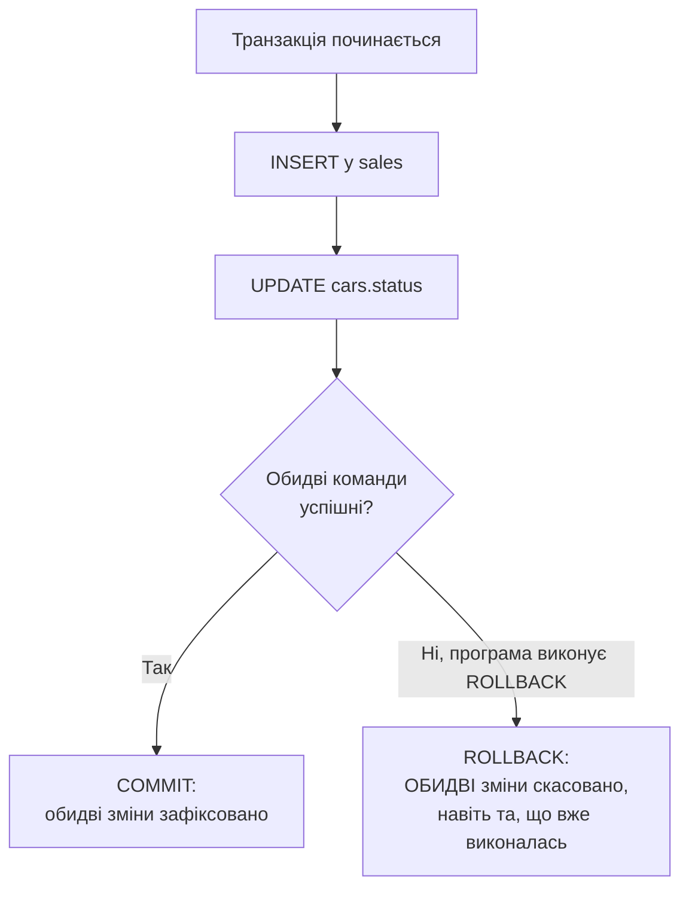

# Лекція 12. Транзакції у SQLite: BEGIN, COMMIT, ROLLBACK. Принципи ACID. Управління блокуваннями

*Практика 14 і наступні вимагатимуть не одну команду, а кілька
пов'язаних, які мають відбутися разом. Наприклад, "продати автомобіль"
означає і додати рядок у `sales`, і позначити авто як `'продано'` у
`cars`. Що станеться, якщо перша команда виконалась, а друга ні (збій
програми, зникло живлення, помилка на другій команді)?*

*Ця лекція пояснює, чому таку "пару" операцій потрібно розглядати як
єдине неподільне ціле, і які гарантії дає транзакція (ACID). Далі
показує, як у SQLite позначити її межі (`BEGIN`, `COMMIT`,
`ROLLBACK`) і що відбувається, коли з базою одночасно працює кілька
процесів.*

## 1. Мотивуюча проблема: розірвана пара операцій

Уявімо продаж автомобіля без жодного спеціального механізму, просто
дві послідовні команди:

```sql
INSERT INTO sales (car_id, client_id, sale_date, sale_price)
VALUES (5, 3, '2025-06-10', 980000);

UPDATE cars SET status = 'продано' WHERE id = 5;
```

Якщо перша команда виконалась, а друга не встигла (програма впала,
зникло живлення, помилка на другій команді), база залишається
в **неузгодженому стані**: запис про продаж уже існує, а сам автомобіль
досі позначений як `'в наявності'`. Другий продавець теоретично може
продати той самий автомобіль вдруге. Проблема не в самому SQL
(обидві команди написані правильно), а в тому, що між ними немає
жодної гарантії "або обидві, або жодна".

## 2. Транзакція: неподільна група операцій

**Транзакція** це група SQL-команд, яка виконується як одне
неподільне ціле: або ВСІ команди групи застосовуються до бази, або
(у разі збою чи свідомої відмови) **жодна**. Проміжного
стану "виконалась лише половина групи" в базі після завершення
транзакції не залишається ніколи.



Рішення "зафіксувати" чи "скасувати" приймається для ВСІЄЇ групи
одразу, а не для кожної команди окремо.

Зверніть увагу, хто саме відкочує. Якщо програма аварійно завершилась
або зникло живлення, незавершену транзакцію SQLite відкотить сам під
час наступного відкриття бази. Якщо ж команда просто повернула
помилку, програма працює далі, і `ROLLBACK` має виконати вона сама
(докладно в розділі 7).

## 3. ACID: чотири властивості надійної транзакції

**ACID** це акронім чотирьох властивостей, які має гарантувати кожна
транзакція в надійній СУБД (включно з SQLite):

- **Atomicity (атомарність)**: "все або нічого". `INSERT` у `sales` і
  `UPDATE` у `cars` або застосовуються ОБИДВА, або жоден. Саме ця
  властивість вирішує мотивуючу проблему з розділу 1.
- **Consistency (узгодженість)**: транзакція переводить базу з одного
  коректного стану в інший коректний стан. Усі обмеження цілісності
  (`NOT NULL`, `UNIQUE`, `CHECK`, зовнішні ключі, Лекції 5 і 6) мають
  виконуватись і до, і після транзакції.
- **Isolation (ізольованість)**: якщо з базою одночасно працює кілька
  користувачів (чи процесів), одна незавершена транзакція не повинна
  бути видимою для іншої, доки не завершиться. SQLite забезпечує це на
  рівні файлу бази через систему блокувань (розділ 10); у СУБД для
  багатьох користувачів, як PostgreSQL, це складніший механізм.
- **Durability (стійкість)**: якщо транзакція завершилась успішно
  (`COMMIT`), її результат гарантовано зберігається навіть у разі
  збою живлення чи аварійного завершення програми одразу після цього:
  дані вже записані на диск, а не лише в пам'яті.

Кожна властивість захищає від власної поломки. Без атомарності пара
операцій розривається (розділ 1). Без узгодженості в базі з'являються
дані, що суперечать правилам предметної області: від'ємний баланс,
продаж неіснуючого автомобіля. Без ізольованості один користувач
бачить недороблені зміни іншого (розділ 10). Без стійкості
підтвердження від бази нічого не варте: користувач бачить повідомлення
«збережено», а після відключення живлення запису немає.

## 4. Без явної транзакції кожна команда сама собі транзакція

```sql
INSERT INTO sales (car_id, client_id, sale_date, sale_price)
VALUES (5, 3, '2025-06-10', 980000);
-- у цьому місці зміна ВЖЕ зафіксована в базі, окремо від наступної команди

UPDATE cars SET status = 'продано' WHERE id = 5;
-- це друга, повністю НЕЗАЛЕЖНА транзакція
```

Це і є причина проблеми з розділу 1: без явних меж кожна окрема
команда SQL виконується як **своя власна, неявна транзакція** і
застосовується одразу, незалежно від сусідніх команд. Щоб дві (чи
більше) команди утворили одну спільну транзакцію, потрібно явно
позначити її межі.

## 5. BEGIN ... COMMIT: фіксація групи змін

Повернімося до бази ветклініки з Лекції 6: у ній є власники
(`owners`) і їхні тварини (`animals`). Додамо нового власника разом з
його твариною: тварина без власника в базі існувати не може, тож обидва
рядки мають з'явитися разом.

```sql
BEGIN;

INSERT INTO owners (id, last_name, first_name, phone)
VALUES (2, 'Коваль', 'Андрій', '0501112233');

INSERT INTO animals (id, name, species, age, owner_id)
VALUES (2, 'Мурка', 'кіт', 3, 2);

COMMIT;
```

`BEGIN` відкриває транзакцію: усі наступні команди стають частиною
однієї групи, а не окремими неявними транзакціями (розділ 4).
`COMMIT` фіксує РАЗОМ усі зміни, зроблені після `BEGIN`: після
`COMMIT` обидва нових рядки (і в `owners`, і в `animals`) присутні в
базі.

## 6. BEGIN ... ROLLBACK: скасування групи змін

```sql
BEGIN;

INSERT INTO owners (id, last_name, first_name, phone)
VALUES (3, 'Тест', 'Тестович', '0509998877');

SELECT id, last_name FROM owners WHERE id = 3;
-- рядок є: його видно всередині цієї ж транзакції...

ROLLBACK;

SELECT id, last_name FROM owners WHERE id = 3;
-- ...але після ROLLBACK результат порожній: рядка в базі немає зовсім
```

`ROLLBACK` скасовує ВСІ зміни, зроблені від останнього `BEGIN`: рядок,
доданий усередині транзакції, зникає повністю, так, наче команда
`INSERT` ніколи не виконувалась.

## 7. Найважливіша пастка: помилка не скасовує транзакцію сама

Створимо таблицю, у якій правило «баланс не може бути від'ємним»
оголошене прямо в структурі:

```sql
CREATE TABLE accounts (
    id      INTEGER PRIMARY KEY,
    owner   TEXT,
    balance INTEGER CHECK (balance >= 0)
);

INSERT INTO accounts (owner, balance) VALUES ('Олена', 300), ('Тарас', 100);
```

Олена хоче переказати Тарасу 500, хоча на її рахунку лише 300. Така
операція мусить бути відхилена цілком. Виконаємо обидві команди без
явної транзакції (розділ 4):

```sql
UPDATE accounts SET balance = balance + 500 WHERE owner = 'Тарас';
UPDATE accounts SET balance = balance - 500 WHERE owner = 'Олена';
```

```text
Runtime error: CHECK constraint failed: balance >= 0
```

Друга команда відхилена обмеженням `CHECK`, але перша вже виконана й
зафіксована сама собою. Порядок команд проблему не знімає: якби першим
ішло списання, воно впало б на перевірці, а зарахування Тарасу все одно
виконалося б, бо команди без явної транзакції незалежні одна від одної.

```sql
SELECT owner, balance FROM accounts;
```

```text
owner  balance
-----  -------
Олена  300
Тарас  600
```

У системі було 400 одиниць, тепер стало 900: Тарас отримав 500, яких
Олена не відправляла. Обмеження `CHECK` спрацювало правильно, але
врятувати цілісність усієї операції воно не могло, бо кожна команда
була окремою транзакцією.

Тепер ті самі команди в явній транзакції (початковий стан: 300 і 100):

```sql
BEGIN;
UPDATE accounts SET balance = balance + 500 WHERE owner = 'Тарас';
UPDATE accounts SET balance = balance - 500 WHERE owner = 'Олена';
```

```text
Runtime error: CHECK constraint failed: balance >= 0
```

**Помилка в другій команді не скасовує транзакцію автоматично**:
перша зміна (Тарас: 600) залишається "в очікуванні" всередині відкритої
транзакції, і вона буде зафіксована, якщо розробник, не зваживши на
помилку, виконає `COMMIT`. Це небезпечно: можна вважати, що вся група
не пройшла (бо була помилка), тоді як частина вже в базі.
**Правильна реакція на помилку всередині транзакції це завжди явний
`ROLLBACK`**:

```sql
ROLLBACK;

SELECT owner, balance FROM accounts;
```

```text
owner  balance
-----  -------
Олена  300
Тарас  100
```

`ROLLBACK` прибрав і ту команду, що вже виконалась успішно: баланси
повернулись до початкових 300 і 100. Те саме стосується будь-якого
порушення обмеження всередині транзакції (`UNIQUE`, `NOT NULL`,
`FOREIGN KEY`): SQLite лише відхиляє команду, що його спричинила, а
рішення про долю решти групи приймає програма.

Цей приклад показує, що властивості ACID працюють разом. Узгодженість
визначає, що вважати помилкою (від'ємний баланс), атомарність дає
змогу скасувати через `ROLLBACK` усю групу, а не лише команду, що
впала, а стійкість гарантує, що результат успішно зафіксованої групи
не зникне.

## 8. Вкладені транзакції заборонені

```sql
BEGIN;
BEGIN;
```

```text
Runtime error: cannot start a transaction within a transaction
```

SQLite не дозволяє відкрити другу транзакцію всередині вже відкритої:
спроба повторного `BEGIN` до `COMMIT`/`ROLLBACK` першої завершується
помилкою. (Для сценаріїв, де потрібна "транзакція всередині
транзакції", SQLite має `SAVEPOINT`, що виходить за межі цього курсу.)
Перша транзакція після такої помилки працює далі, і її все одно треба
завершити командою `COMMIT` або `ROLLBACK`.

## 9. Практичний шаблон: атомарна пара INSERT + UPDATE

```sql
BEGIN;

INSERT INTO sales (car_id, client_id, sale_date, sale_price)
VALUES (5, 3, '2025-06-10', 980000);

UPDATE cars SET status = 'продано' WHERE id = 5;

COMMIT;
```

Це розв'язок мотивуючої проблеми з розділу 1: обидві команди
всередині однієї транзакції або обидві зафіксуються `COMMIT`, або (у
разі помилки чи свідомого `ROLLBACK`) жодна з них не залишить слід у
базі. Автомобіль ніколи не опиниться в стані "продано без запису
продажу" чи "запис продажу без позначки продано".

## 10. Блокування й ізольованість: що відбувається, коли два процеси пишуть одночасно

Навіщо потрібна ізольованість, видно на прикладі. Нехай продавець А
почав оформлювати продаж автомобіля й змінив його статус на
`'продано'`, але операцію ще не завершив:

| Крок | Продавець А | Продавець Б |
|---|---|---|
| 1 | змінює статус авто на `'продано'`, транзакція ще не завершена | |
| 2 | | читає статус `'продано'` і відмовляє своєму клієнтові |
| 3 | клієнт не оплатив, тож А скасовує транзакцію (`ROLLBACK`) | |
| 4 | авто знову `'в наявності'` | продаж втрачено |

Продавець Б ухвалив рішення на даних, яких насправді ніколи не
існувало. Ізольованість гарантує, що Б побачить зміну А лише після її
фіксації.

SQLite це файлова база, і ізольованість у ній реалізована через
систему блокувань просто на рівні файлу бази, без окремого серверного
процесу. Коли транзакція доходить до першої команди, що змінює дані
(`INSERT`, `UPDATE`, `DELETE`), SQLite встановлює на файл бази
**RESERVED**-блокування. Інші процеси й далі можуть читати базу
(`SELECT`), але бачать лише останню зафіксовану версію: для продавця Б
автомобіль досі `'в наявності'`, доки А не виконав `COMMIT`. Писати ж
не може жоден інший процес, доки поточна транзакція не завершиться
`COMMIT` чи `ROLLBACK`. Блокується вся база, а не окремий рядок чи
таблиця: навіть якщо Б змінює інший автомобіль, він отримає відмову.
Якщо другий процес спробує писати в той самий момент:

```text
Runtime error: database is locked
```

Це не збій. SQLite навмисно не пускає двох записувачів одночасно, щоб
вони не зіпсували дані один одному. Студенти найчастіше бачать цю
помилку так: у DB Browser є незбережені зміни (не натиснуто "Write
Changes"), а скрипт чи консоль `sqlite3` пише в ту саму базу. У
програмах вона виникає, коли кілька процесів пишуть у той самий файл
`.db` (наприклад, десктопний застосунок і фоновий скрипт-імпортер).
Тому транзакції на запис варто робити короткими: довга транзакція
тримає блокування і змушує інших чекати.

SQLite дозволяє пом'якшити цю поведінку параметром `busy_timeout`:
замість негайної помилки SQLite чекає вказану кількість мілісекунд,
повторно намагаючись отримати блокування, перш ніж здатися:

```sql
PRAGMA busy_timeout = 5000;  -- чекати до 5 секунд, перш ніж повернути помилку
```

Для бази, з якою працює один процес, таке налаштування не потрібне,
воно стає важливим, щойно ту саму базу паралельно використовує кілька
процесів.

## 11. Чого ACID не гарантує

Є кілька поширених помилкових уявлень.

Транзакція не перевіряє **змістової правильності** даних. Якщо в базі
немає обмеження `CHECK (balance >= 0)`, то нічого не завадить зробити
баланс від'ємним, і транзакція це спокійно зафіксує. Узгодженість у
значенні ACID означає лише дотримання тих правил, які ви самі оголосили
в схемі.

Транзакція не робить запит швидшим і не замінює індекси: це механізм
надійності, а не продуктивності. Більше того, довга транзакція може
заважати іншим користувачам, бо тримає блокування (розділ 10).

Нарешті, ACID гарантує поведінку **в межах однієї бази**. Якщо програма
пише в базу, а потім відправляє лист, відкотити лист транзакція не
зможе: зовнішні дії лежать поза її контролем.

## 12. Запитання для самоперевірки

**Користувач натиснув «Оплатити», програма вставила рядок у `orders`, а на другій команді сталася помилка. У якому стані опиниться база без явної транзакції?**

У неузгодженому: замовлення існує, але супутня зміна (наприклад, зменшення залишку на складі) не виконана. Порушена атомарність, бо дві пов'язані дії не були об'єднані в одну транзакцію.

**Яка властивість ACID гарантує, що після `COMMIT` і раптового вимкнення комп'ютера дані збережуться?**

Стійкість (Durability): успішно зафіксований результат уже записаний на диск, а не лише в оперативну пам'ять.

**Усередині транзакції друга команда завершилась помилкою `UNIQUE constraint failed`. Що з першою командою і що робити далі?**

Транзакція лишилась відкритою, перша команда "очікує" фіксації. Помилка сама нічого не скасовує, тож програма має явно виконати `ROLLBACK`; якщо виконати `COMMIT`, перша зміна збережеться, а друга ні.

**Двоє користувачів одночасно змінюють одну таблицю. Чому один не повинен бачити незавершені зміни іншого і що робить SQLite, коли обидва хочуть писати?**

Це вимога ізольованості: незавершену транзакцію ще можуть скасувати, тож рішення на основі її проміжних даних виявилися б помилковими. SQLite дозволяє писати лише одній транзакції за раз (RESERVED-блокування), інша отримає `database is locked` або почекає, якщо задано `busy_timeout`.

**Чому наявності обмеження `CHECK` недостатньо, щоб переказ коштів був безпечним?**

Обмеження відхиляє лише ту команду, що його порушує. Якщо до цього вже виконалась інша команда групи, її результат лишається. Щоб скасувалась уся група, її об'єднують в одну транзакцію й після помилки виконують `ROLLBACK`.

## Підсумок

- Транзакція це неподільна група SQL-команд: результат застосовується
  до бази або весь одразу, або не застосовується взагалі.
- **ACID**: Atomicity (все або нічого), Consistency (обмеження
  цілісності виконуються завжди), Isolation (незавершена транзакція не
  видима іншим), Durability (зафіксований результат переживає збій).
- Без явного `BEGIN`/`COMMIT` кожна окрема команда власна неявна
  транзакція, тому пов'язана пара команд без явних меж може
  "розірватися" при збої між ними.
- `BEGIN` відкриває транзакцію; `COMMIT` фіксує всі зміни від `BEGIN`
  разом; `ROLLBACK` скасовує їх усі, включно з тими, що вже
  "виконались" усередині транзакції.
- Помилка всередині транзакції НЕ скасовує її автоматично: якщо після
  помилки забути `ROLLBACK` і виконати `COMMIT`, зафіксуються команди,
  що пройшли без помилки, і база лишиться зміненою частково.
- SQLite не дозволяє вкладені транзакції: повторний `BEGIN` до
  завершення першої завершується помилкою.
- Поки транзакція на запис не завершена, SQLite тримає на файлі бази
  блокування, що не пускає інші процеси писати паралельно
  ("database is locked"); `PRAGMA busy_timeout` дозволяє почекати на
  звільнення блокування замість негайної помилки.
- Транзакція гарантує дотримання лише тих правил, які оголошено в
  схемі (`CHECK`, `NOT NULL`, ключі), а не змістову правильність даних.

!!! tip "Інтерактивна версія"
    Усі приклади можна виконати в браузері й подивитися, що лишиться в базі після «збою» на будь-якій команді, а також спробувати BEGIN, COMMIT, ROLLBACK і пастку «помилка не скасовує транзакцію»: [Тренажер SQL — Лекція 12](../lapa/index.html#lecture-12).

**Практика до цієї лекції:** [Практика 14. Створення та відкат транзакцій у SQLite](../practice/14-transactions.md)

## Рекомендована література

Павловський В. І., Петрашенко А. В. *Бази даних та засоби управління.* — Київ: КПІ ім. Ігоря Сікорського, 2024 ([відкритий доступ](https://ela.kpi.ua/bitstreams/9f26675d-c42f-485e-aab5-13e6e014b560/download)). Розділ про транзакції та багатокористувацький паралельний доступ: властивості транзакцій, рівні ізоляції.

Павловський В. І., Петрашенко А. В., Победа Д. В. *Бази даних та засоби управління. Практикум.* — Київ: КПІ ім. Ігоря Сікорського, 2021 ([відкритий доступ](https://ela.kpi.ua/server/api/core/bitstreams/1b620029-0db7-4e2e-83e7-32f7722a69be/content)). Розділ «Ізоляція транзакцій»: паралельні транзакції, проблеми узгодженості даних.
