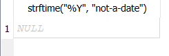

**Завдання 1**

Відформатований вивід зробив всі значення із двома знаками після крапки і додав одиниці. Це полегшує перегляд даних, що було б важко у сирому форматі

**Завдання 2**

Вирівнювання необхідне для того, щоб наперед знати максимальний розмір стовпця і щоб дані були під однією лінією(справа або зліва), що полегшує читання

**Завдання 3**

Такий зсув показує: до якої конкретної дати замовлені товари треба відправити

**Завдання 4**

Довелося групувати за strftime, тому що групування за наявними значеннями показало би результати по кожному дню, а треба помісячно

**Завдання 5**

Повернувся такий результат:

Повернений NULL показує, що будь-яка дата не в ISO фоматі чи не є датою, через strftime та date повертає NULL, а помилок не показує. Це означає, що для правильного відображення даних треба наперед вказати формат дати, бо інакше робота з датами повертатиме NULL

**Контрольні питання**

Чим printf() для форматування виводу відрізняється від зміни самого значення, що зберігається в таблиці — чи змінюється колонка фізично після запиту з printf()?  
Він відрізняється тим, що не змінює значення в таблиці, а лише змінює те, що виводиться. Наприклад у таблиці в колонці ціна пише 5, то printf може це значення перетворити на 5.00 грн

Чому strftime('%Y', колонка) повертає рік як текст, а не як число, і коли це може мати значення (наприклад, при сортуванні чи порівнянні)?  
Тому що метод використовує рядкове форматування. Це може мати значення при сортуванні та порівнянні, бо рядки обробляються інакше ніж числа.

Що з висновком Завдання 5 означає для написання CHECK-обмежень (Лекція 6) на колонки з датами?  
Він означає те, що треба завжди задавати обмеження на формат та правильність введених значень, інакше не вийде нормально посортувати дані