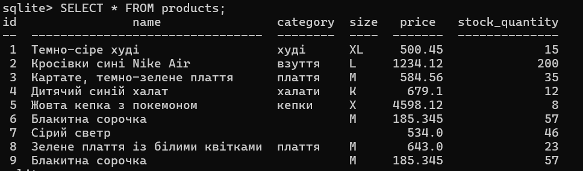
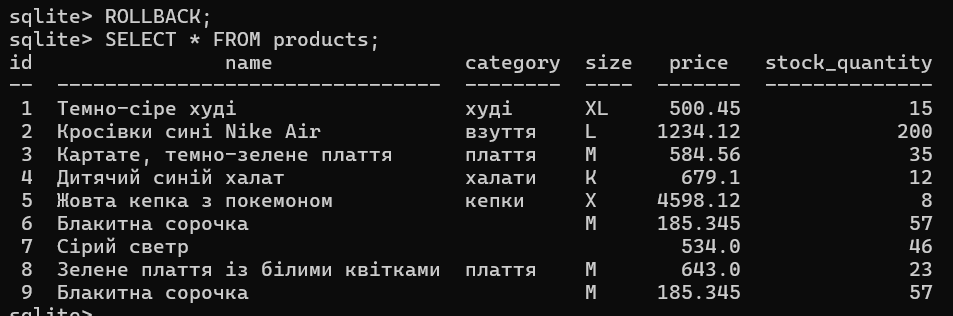

**Завдання 1**

Додавання замовлення та оновлення кількості товарів на складі мають відбуватися одночасно, щоб не вийшло продати товар, якого 0 і щоб не забути оновити значення для уникнення помилок.

**Завдання 2**

Перед новою транзакцією глянули, які дані на даний момент. Після транзакції перевірили чи нічого не змінилось. Виявилося, що жодних змін не відбулось.

ДО:

ПІСЛЯ:

**Завдання 3**

Під час транзакції вивелось, що вже таблиця зі змінами. Але це не означає, що зміни збереглися, бо транзакцію ще не закінчено. Тому це не суперечить тому, що до COMMIT зміна ще не остаточна.

**Завдання 4**

Попри неправильність останньої команди, перша зафіксувалась у базі, але ще не збережена. Скасовуємо всю транзакцію.

**Завдання 5**

Після COMMIT збереглися успішні зміни, але неуспішна(зміна ціни) - ні. Це може призвести до того, що попри намір зменшити ціну для більшого заохочення, вона залишиться та сама, а компанія втратить продажі. При тому збереження відбулось, бо сама помилка не скасовує всю транзакцію.

**Контрольні питання**

У Завданні 1: що саме пішло б не так із базою, якби ці дві зміни виконувалися двома окремими, не пов’язаними транзакціями і між ними стався б збій?  
Кожна зміна зберігалася б окремо. Якби не встигло виконати другу, то перша всеодно була б збережена. Це може призвести до бізнес-втрат та порушило б бізнес-логіку. Завжди краще, коли людина може вирішити чи зберігати все чи скасувати все.

Чому в Завданні 5 результат після COMMIT саме «перша зміна є, другої немає», а не «нічого не застосувалося» чи «обидві застосувалися»?  
Тому що COMMIT зберігає зміни транзакції. Якщо виникає помилка, то зберігається те, що не має помилки. Щоб нічого не застосувалося треба виконати ROLLBACK, а щоб всі - виконати всі запити правильно

Атомарність – це «все або нічого» (лекція 12). Чому ж після Завдання 5 у базі лишилася лише частина змін: що тут гарантувала СУБД, а що мав зробити розробник?  
СУБД гарантувала, що після COMMIT буде додано все, що можна, а ROLLBACK не застосує зміни. Розробник мав сам вирішити, що обрати: додати все безпомилкове чи скасувати всі зміни