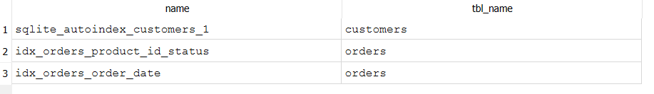

**Завдання 2**

Тепер замість SCAN, буде виконуватись SEARCH. Це означає, що вже задіяно INDEX, через що буде швидше шукати

**Завдання 3**

До індексу таблиця сканувалася, а з ним вже шукає по product_id, і у ньому по статусу

**Завдання 4**

Спочатку був SCAN та USE B-TREE, а з індексом лише SCAN. У першому плані сортування відбувалося другим кроком. У другому сортування вже було разом зі SCAN одним кроком

**Завдання 5**

Після видалення індексу, sqlite3 почав використовувати інший індекс(idx_orders_product_id_status). Перевірка показала, що видаленого індексу вже не існує:

**Контрольні питання**

Чому EXPLAIN QUERY PLAN показує саме план, а не результат запиту, і навіщо перевіряти план окремо від того, що запит просто «працює»?  
EXPLAIN QUERY PLAN показує план, а не результат. Усе тому, що ця команда призначена лише для показу плану пошук, а для результату запиту існує SELECT. План варто перевіряти окремо від того, що запит просто «працює», бо іноді може план не використовувати індекс, що сповільнить пошук. Або може використовуватися неправильний індекс, що змінює результат. Основною метою додаткової перевірки є уникнення помилок.

У Завданні 3: чому індекс лише на першій із двох колонок умови дає менший ефект, ніж композитний індекс на обох?  
Індекс лише на першій із двох колонок дасть менший ефект, бо якщо треба шукати за двома колонками, то спершу буде SEARCH, а потім SCAN, що сповільнює виконання запиту. Композитний індекс дозволяє швидше знаходити дані через один SEARCH.

Яка ціна створення індексу (лекція 13, розділ 15) і чому не варто індексувати кожну колонку таблиці «про всяк випадок»?  
Коли створюється індекс, то використовується додаткове сховище. Якщо база даних велика, то й індекс буде великим. Не варто індексувати кожну колонку таблиці, щоб економити місце для бази даних.