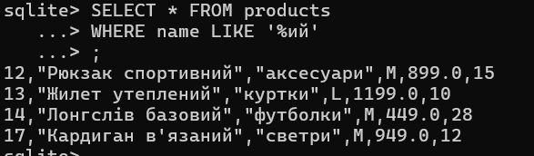

**Завдання 1**

До додавання нових даних було 9 записів

**Завдання 3**

Після додавання нових рядків стало бути 17 записів. 17 - 9 = 8 нових рядків

**Завдання 4**

id рядків у результаті нові і не почались з нуля:

**Завдання 5**

Вивелося повідомлення про недостатню кількість даних і про невідповідні типи. Попри це дані всеодно додались. Проблема була в тому, що в csv-файлі було лише 5 колонок, а таблиця очікувала 6(включно з id). Таблиця пробує підставити перше значення в колонку з id, що створює конфлікт

**Контрольні питання**

Чому CSV-файл цієї практики навмисно не містить колонку id: що б сталося, якби спробувати додати її туди самостійно з довільними значеннями?  
CSV-файл цієї практики навмисно не містить колонку id для того, щоб ми могли побачити, що станеться через різну кількість колонок та щоб id нових даних не конфліктували зі старими. Якщо спробувати додати колонку id самостійно, то може виникнути помилка, бо таблиця може містити колонку вже з наявним id.

Яка роль DROP TABLE проміжної таблиці в кінці процесу: чи можна просто залишити її в базі «про всяк випадок»?  
DROP TABLE проміжної таблиці видаляє дані, які треба передати у звичайну таблицю. Її не можна залишати, бо колись знову доведеться додавати дані, а проміжна міститиме старі дані, що вже додані та нові, що треба додати. При додаванні даних із проміжної в основну додадуться копії вже наявних даних, що може порушити цілісність даних.

Чим підрахунок COUNT(*) до й після імпорту (Завдання 1 і 3) кращий за враження «здається, що імпорт спрацював»?  
Підрахунок дозволяє додатково перевірити чи додалися дані. Він кращий за враження, бо показує факт виконання або невиконання імпорту.