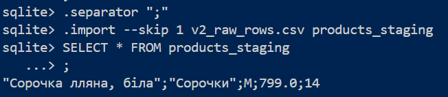
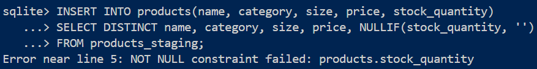

**Завдання 1**

Попередження було виведено, бо у файлі колонки розділені крапкою з комою, а sqlite за замовчуванням вважає роздільником кому. Через це перший рядок додався у дві колонки, а всі інші лише в одну

**Завдання 2**

Попередження відсутні:

**Завдання 3**

Було виявлено, що два значення не мають заповненої колонки кількості товару. У цій колонці також був тип text. Назви рядків у яких виявлено: Ремінь шкіряний, Шарф кашеміровий. Також два рядки були однаковими. Їхня назва: Шорти джинсові
Приблизно має додатися 7 значень

**Завдання 4**

Не вдалося виконати запит із заміною порожніх рядків на NULL, бо стоїть обмеження:

Після додавання стало 24 записи, що збігається із приростом на 7 записів(було 17, 17 + 7 = 24)

**Завдання 5**

Значення розділені комою. Значення з комою записані в лапках. Результат з NULL за цим запитом невідомий, але якби був, то замість нього просто нічого не було б(хіба що кома). Якби з NULL перетворювали назад, то був би пустий text ''.

**Контрольні питання**

Чому імпорт файлу з крапкою з комою в режимі .mode csv формально «проходить», але дає неправильний результат, і як це помітити?  
Імпорт формально проходить, бо рядок теж вважється значенням. Просто в результаті додадуться значення не всі колонки, а в одну чи дві залежно від ком самих значень. Це можна помітити за попередженням, а також за заповненням колонок

Чому порожнє поле CSV треба перетворювати на NULL і чим загрожує порожній рядок у числовій колонці для агрегатних функцій?  
Порожнє поле треба перетворювати на NULL, щоб не було конфлікту типів і щоб це значення не бралось до уваги при роботі. Порожній рядок у числовій колонці порожній рядок для агретних функцій загрожує неправильними розрахунками, помилками та неправильними результатами

Чому дублікати й порожні значення краще знаходити в проміжній таблиці, а не вже в цільовій?  
Їх легше знаходити у проміжній таблиці, бо там лише ті значення, що додаються і вони не впливають на роботу бази, на відміну від пошуку в цільовій.