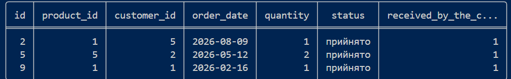
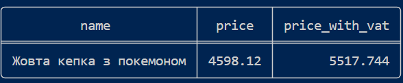
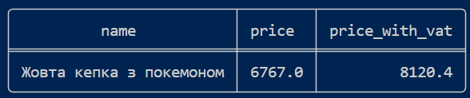

**Завдання 1**

Було додано колонку з ціною разом із ПДВ. Сенс цього рішення в тому, що на сайті треба вказувати ціну разом з податками, щоб бізнес менше втрачав прибутків. Базова ціна залишається - і дозволяє знати приблизну суму грошей, яку бізнес отримає назад

**Завдання 2**

Перевірка:

**Завдання 3**

Текст помилки:  
Parse error near line 26: cannot UPDATE generated column "price_with_vat"

**Завдання 4**

Після оновлення ціни, ціна з пдв збільшилась автоматично.

Було:  

Стало:  

**Завдання 5**

Такий запис зручніший ніж повторення, бо пришвидшує написання запиту, а також не потрібно переглядати формулу для фільтрування(не дуже зручно десь шукати чи згадувати, що вирішується згенерованою колонкою)

**Контрольні питання**

Чому в цій практиці можна створити лише VIRTUAL, а не STORED згенеровану колонку і що саме в наявній таблиці цьому заважає (лекція 14, розділ 9)?  
Тому що, STORED створюємо лише під час створення таблиці. У практиці використовували наявні таблиці. STORED не можна використати під час ALTER TABLE, оскільки тоді доведеться до кожної колонки зразу обчислити значення і використати більшу частину сховища

Що станеться, якщо спробувати видалити (DROP COLUMN) базову колонку, від якої залежить згенерований стовпець?  
Видасть помилку і не видалить колонку

Чому неможливість прямого INSERT чи UPDATE у згенеровану колонку (Завдання 3) є перевагою, а не обмеженням?  
Це є перевагою, оскільки не довзоляє зруйнувати логіку обчислення колонки, а також не введе в оману неправильне значення